<p align="center">
  
</p>

<h1 align="center">Downsmith</h1>

<p align="center">
  <strong>Shape your Markdown.</strong><br>
  A small, quick Markdown editor for macOS and Linux, built for AI agents: watch them write, see what changed.
</p>

<p align="center">
  <a href="../../releases/latest"><b>⬇️ Download the latest release</b></a>
  &nbsp;·&nbsp;
  <a href="https://downsmith.dev">Website</a>
  &nbsp;·&nbsp;
  <a href="https://downsmith.dev/de/">Deutsch</a>
</p>

<p align="center">
  
  
  
</p>

<p align="center">
  <picture>
    <source media="(prefers-color-scheme: dark)" srcset="img/app-dark.png">
    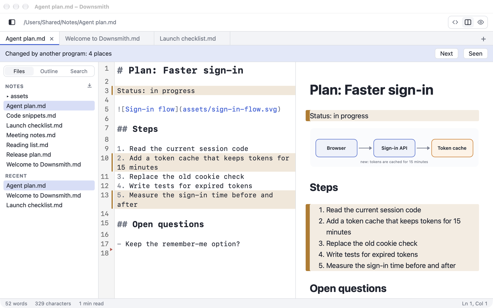
  </picture>
</p>

## Why Downsmith

- **Built for AI agents.** Coding agents write plans, specs and notes as Markdown. Downsmith follows the file as the agent rewrites it and marks what changed, in the source and in the preview, with *Next change* and *Seen*. It can also follow the newest Markdown file of a folder. Downsmith itself has no AI and sends nothing anywhere.
- **Diagrams and math.** Mermaid code blocks are drawn as diagrams (flowcharts, sequence, class, state, Gantt …) and formulas in `$…$` or `$$…$$` are typeset, in light and dark, offline. The HTML export keeps them.
- **Images.** Local images (also SVG) show in the preview. Paste a screenshot or drop an image into the editor and it is copied into an `assets` folder next to the document. Images from the web are not loaded.
- **Live preview.** Source on the left, rendered page on the right, scrolling together. Tables, task lists you can tick off, footnotes, note boxes and code blocks with syntax highlighting.
- **Write.** Bold, italic, links and headings from the Format menu. Focus mode fades everything but the current paragraph, typewriter scrolling keeps your line in the middle, and a status bar counts words and reading time.
- **Find and jump.** Search and replace, search every Markdown file of a folder (`⇧⌘F`) with a click to the hit, a command palette (`⇧⌘P`) for any command or file, and an outline of your headings in the sidebar.
- **Always up to date.** When another program changes an open file, Downsmith shows the new text (and asks first if you have unsaved edits). Drop files or a folder on the window to open them.
- **Tabs.** Open several files at once, each with its own undo history. Your tabs come back at the next start, and closing with unsaved changes asks Save, Don't Save or Cancel.
- **Your view.** Show only the source, only the preview or both side by side. Hide the sidebar and drag the dividers to resize the columns. Downsmith remembers your layout.
- **Folders and recent files.** Open a folder, browse its Markdown files in a sidebar and jump back to what you edited last.
- **Native.** The real menu bar with the shortcuts you know, in English or German. It uses the system web view instead of shipping a browser, so the macOS download is about 13 MB, diagrams and math included.
- **Light and dark.** Editor, preview and export follow your system appearance.
- **Export.** Save a self-contained HTML page, or print to PDF through the system dialog.
- **Private.** It works offline and sends nothing anywhere. Your documents stay on your computer.

## A look around

<table>
  <tr>
    <td width="50%">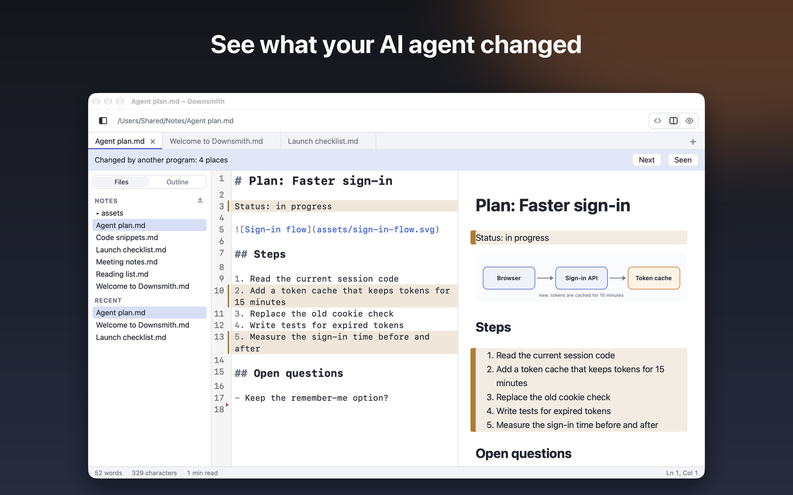</td>
    <td width="50%">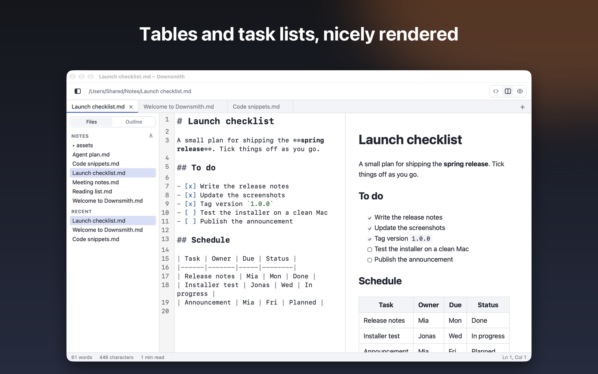</td>
  </tr>
  <tr>
    <td width="50%">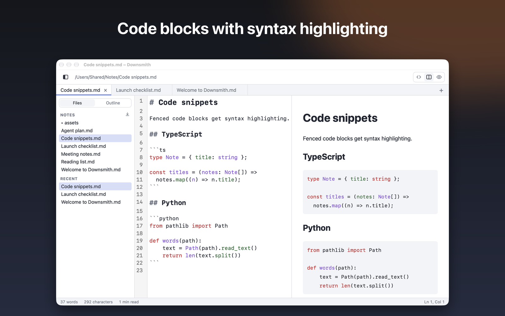</td>
    <td width="50%">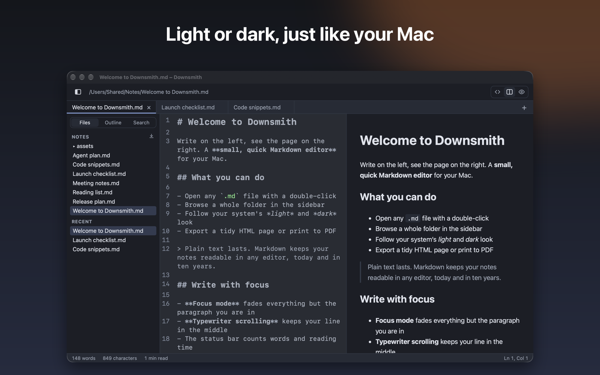</td>
  </tr>
  <tr>
    <td width="50%">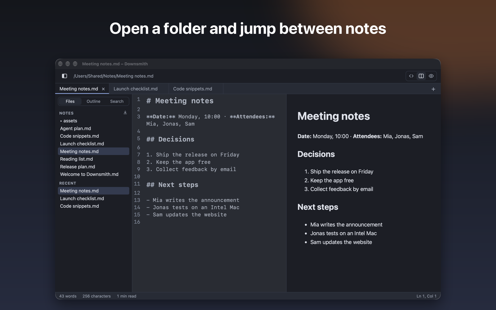</td>
    <td width="50%">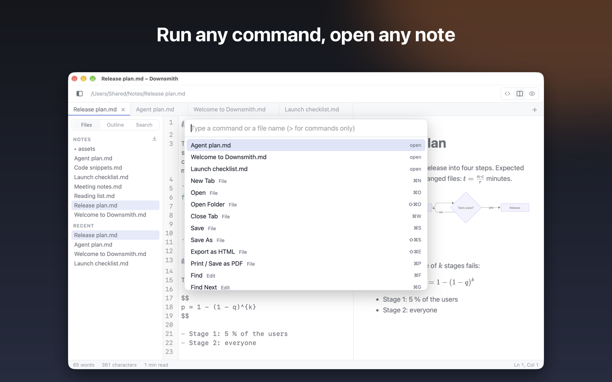</td>
  </tr>
  <tr>
    <td width="50%">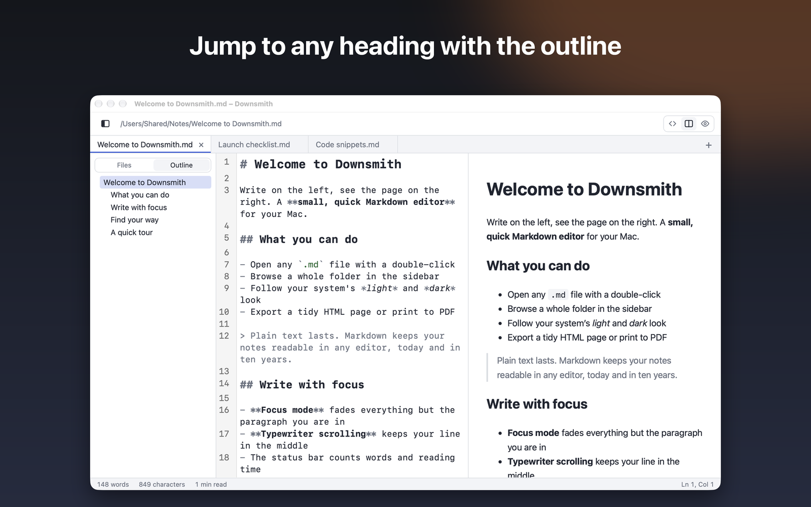</td>
    <td width="50%">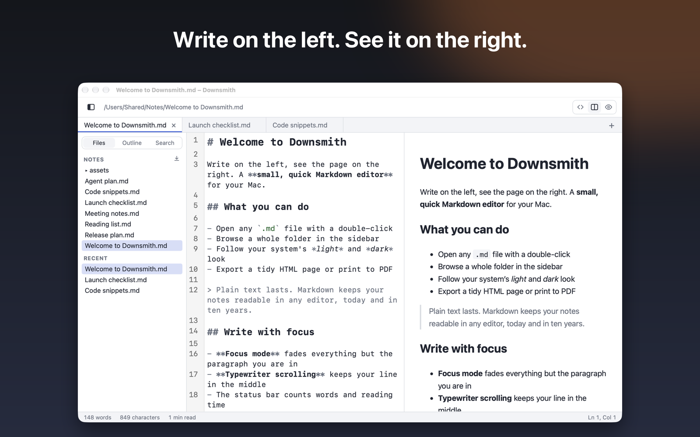</td>
  </tr>
  <tr>
    <td width="50%">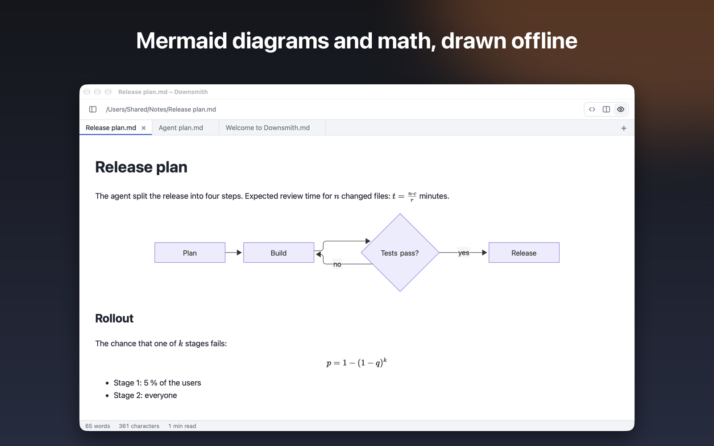</td>
    <td width="50%">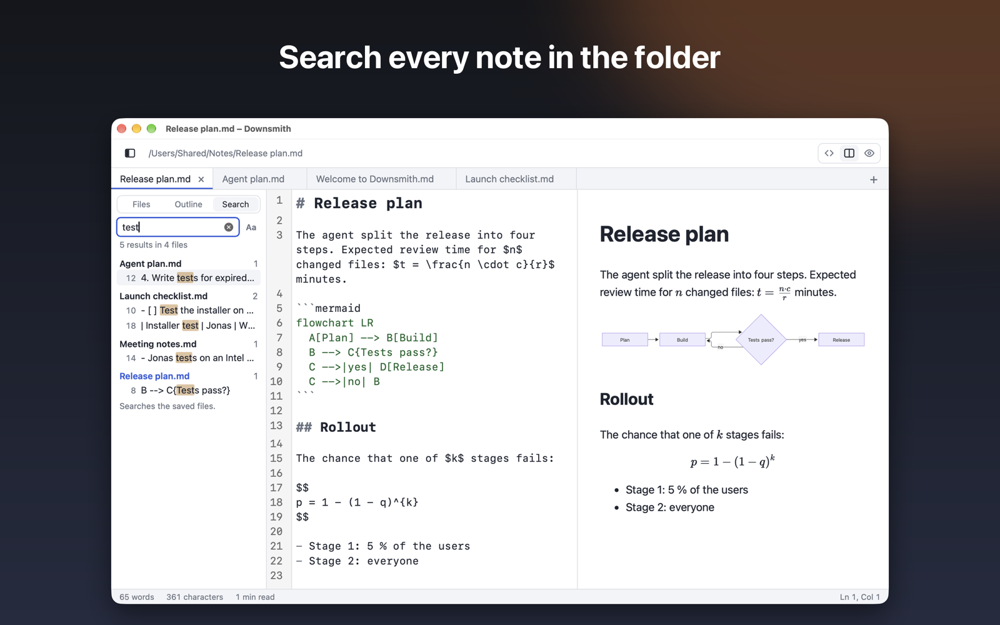</td>
  </tr>
</table>

## Use it with your agent

Open the file your agent is working on:

```sh
open -a Downsmith plan.md   # macOS
downsmith plan.md           # Linux (.deb and .rpm packages)
```

To let the agent do it, add a line like this to its instructions file (`AGENTS.md` or `CLAUDE.md`):

> When you write a plan or spec, open it with `open -a Downsmith <file>` so I can follow it.

Switch on **View > Follow Newest File** to have Downsmith open whichever Markdown file in the sidebar's folder was written last.

## Install

Grab the file for your system from the **[latest release](../../releases/latest)**.

### macOS (13 Ventura or later, Apple silicon and Intel)
1. Download the `.dmg`, open it and drag **Downsmith** onto *Applications*.
2. Start it. The app is signed and notarized by Apple, so there is no Gatekeeper warning.

Downsmith is also in the [Mac App Store](https://apps.apple.com/app/id6818861246).

### Linux (64-bit)
| Package | Install |
|---|---|
| `.AppImage` | `chmod +x Downsmith_*.AppImage && ./Downsmith_*.AppImage` |
| `.deb` (Debian, Ubuntu) | `sudo apt install ./Downsmith_*_amd64.deb` |
| `.rpm` (Fedora, openSUSE) | `sudo dnf install ./Downsmith-*.rpm` |

The packages need WebKitGTK 4.1 (`libwebkit2gtk-4.1`). The Linux builds are new and have seen less testing than the macOS app. If something does not work, please [open an issue](../../issues) or write to <contact@downsmith.dev>.

## Keyboard shortcuts

| Action | macOS | Linux |
|---|---|---|
| New tab | `⌘N` | `Ctrl+N` |
| Open file | `⌘O` | `Ctrl+O` |
| Open folder | `⇧⌘O` | `Ctrl+Shift+O` |
| Close tab | `⌘W` | `Ctrl+W` |
| Next / previous tab | `⇧⌘]` / `⇧⌘[` | `Ctrl+Shift+]` / `Ctrl+Shift+[` |
| Save / Save as | `⌘S` / `⇧⌘S` | `Ctrl+S` / `Ctrl+Shift+S` |
| Export as HTML | `⇧⌘E` | `Ctrl+Shift+E` |
| Print / Save as PDF | `⌘P` | `Ctrl+P` |
| Show or hide the sidebar | `⇧⌘B` | `Ctrl+Shift+B` |
| Source only / both / preview only | `⌥⌘1` / `⌥⌘2` / `⌥⌘3` | `Ctrl+Alt+1` / `2` / `3` |
| Larger / smaller / actual text size | `⌘+` / `⌘-` / `⌘0` | `Ctrl+` / `Ctrl-` / `Ctrl+0` |
| Find / next / previous | `⌘F` / `⌘G` / `⇧⌘G` | `Ctrl+F` / `Ctrl+G` / `Ctrl+Shift+G` |
| Find and replace | `⌥⌘F` | `Ctrl+Alt+F` |
| Find in folder | `⇧⌘F` | `Ctrl+Shift+F` |
| Command palette | `⇧⌘P` | `Ctrl+Shift+P` |
| Bold / italic / link | `⌘B` / `⌘I` / `⌘K` | `Ctrl+B` / `Ctrl+I` / `Ctrl+K` |
| Inline code / strikethrough | `⌘E` / `⇧⌘X` | `Ctrl+E` / `Ctrl+Shift+X` |
| Heading 1 / 2 / 3 | `⌘1` / `⌘2` / `⌘3` | `Ctrl+1` / `2` / `3` |
| Focus mode / typewriter scrolling | `⇧⌘D` / `⌥⌘T` | `Ctrl+Shift+D` / `Ctrl+Alt+T` |
| Status bar | `⌘/` | `Ctrl+/` |
| Show outline / show files | `⌥⌘O` / `⌥⌘L` | `Ctrl+Alt+O` / `Ctrl+Alt+L` |
| Next / previous change | `⌥⌘↓` / `⌥⌘↑` | `Ctrl+Alt+Down` / `Ctrl+Alt+Up` |

## Support

Downsmith is free and always will be. If it saves you time, a small donation helps me keep building it: **[github.com/sponsors/alexelmi](https://github.com/sponsors/alexelmi)**.

## About this repository

This repository only hosts the download files (see [Releases](../../releases)) and this page. Downsmith's source code is in a private repository. Questions, bug reports and ideas are welcome in the [issues](../../issues) or at <contact@downsmith.dev>.
